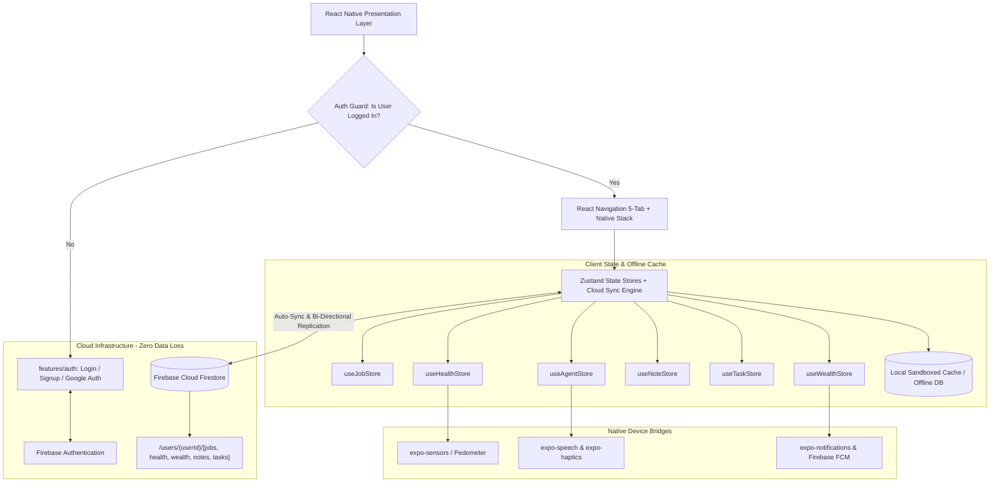

# 🏗️ Personal App: System Architecture & Technical Design

**Project Name:** Personal Life OS & AI Executive Assistant  
**Stack:** Expo (React Native) + TypeScript + Zustand + AsyncStorage  
**Design Philosophy:** Local-First, Zero-Latency, 100% Offline Capable, Battery-Efficient  

---

## 1. High-Level Architecture Overview



---

## 2. Enterprise Domain-Driven & Feature-Sliced Structure

The codebase strictly follows a **Domain-Driven Architecture (DDA)** with decoupled feature modules and a robust `core/` infrastructure:

```
Personal_App/
├── App.tsx                           # Application Root & Providers Registry
├── app.config.js                     # Expo Dynamic Config, Bundle IDs, Plugins
├── index.ts                          # Mobile App Entrypoint
├── package.json                      # Dependencies & Scripts
├── tsconfig.json                     # Strict TypeScript & Path Mappings (@/*)
│
├── Document/                         # Architecture & Specification Docs
│   ├── features.md
│   ├── ARCHITECTURE.md
│   ├── DATA_MODELS.md
│   ├── UI_UX_FLOW.md
│   ├── IMPLEMENTATION_ROADMAP.md
│   ├── DESIGN_SYSTEM_AND_UI_UX.md
│   └── ENTERPRISE_STRUCTURE.md       # Comprehensive Enterprise Blueprint
│
├── assets/                           # Media & Typography Assets (Icons, Fonts, Sounds)
│
└── src/
    ├── config/                       # Global Constants, Env & Feature Flags
    │
    ├── core/                         # Enterprise Infrastructure & Foundation
    │   ├── design-system/            # Atomic Design Tokens & UI Primitives (Box, Text, GlassCard, Button)
    │   ├── storage/                  # AsyncStorage Engine, Encrypted Vault & Migrations
    │   ├── native-bridges/           # Pedometer, Notifications, Haptics, Speech, Biometrics
    │   └── utils/                    # Currency, DateTime, Vatti Math, ATS Matcher
    │
    ├── navigation/                   # Deep Navigation, RootNavigator & BottomTabNavigator
    │
    └── features/                     # Autonomous Self-Contained Domain Modules
        ├── today/                    # 🏠 Command Center (Tasks, Habits, Pomodoro)
        │   ├── components/ | hooks/ | screens/ | state/ | types.ts
        ├── career/                   # 💼 Career Pipeline, ATS Matcher & Recruiter CRM
        │   ├── components/ | hooks/ | screens/ | state/ | services/ | types.ts
        ├── health/                   # 🏃 Google Fit Activity Hub, Water & Sleep
        │   ├── components/ | hooks/ | screens/ | state/ | services/ | types.ts
        ├── wealth/                   # 💰 Wealth, Gold, Kadan/Vatti Engine, Trips & Groceries
        │   ├── components/ | hooks/ | screens/ | state/ | services/ | types.ts
        ├── vault/                    # 📝 Notes & Second Brain
        │   ├── components/ | hooks/ | screens/ | state/ | types.ts
        └── agent/                    # 🤖 AI Copilot, Sunday Reset & Voice Assistant
            ├── components/ | hooks/ | screens/ | state/ | services/ | types.ts
```

---

## 3. State Management & Offline-First Persistence Architecture

### Why Zustand?
1. **Lightweight & Fast:** Zero boilerplate compared to Redux, sub-millisecond execution.
2. **Modular Stores:** Each domain (`job`, `health`, `money`, `note`, `task`) maintains its own independent store.
3. **Automatic AsyncStorage Hydration:** State updates instantly in memory, and asynchronously syncs to device storage using `zustand/middleware` `persist`.

### Persistence Protocol:
```typescript
// Pattern used across all stores:
import create from 'zustand';
import { persist, createJSONStorage } from 'zustand/middleware';
import AsyncStorage from '@react-native-async-storage/async-storage';

export const useMoneyStore = create(
  persist(
    (set, get) => ({
      loans: [],
      goldItems: [],
      // actions...
    }),
    {
      name: 'personal-app:money-store-v1',
      storage: createJSONStorage(() => AsyncStorage),
    }
  )
);
```

---

## 4. Hardware Sensors & Native Bridges

### 4.1 Pedometer & Motion Tracking (`expo-sensors`)
- Queries hardware step counter sensors available on Android (`android.permission.ACTIVITY_RECOGNITION`) and iOS (`CoreMotion`).
- Automatically accumulates daily step history and maintains hourly distribution bins.

### 4.2 Local Notification Engine (`expo-notifications`)
- Schedules offline recurring alerts without needing a remote push server:
  - **Vatti / Loan Due Alert:** Scheduled on 1st of every month and 3 days before due date.
  - **Hydration Water Ping:** Interval timer (every 60-90 minutes between 9 AM and 9 PM).
  - **20-20-20 Ergonomics Alert:** Desk screen-time reminder during active focus.

### 4.3 Biometric Security (`expo-local-authentication`)
- Uses Android BiometricPrompt and iOS FaceID/TouchID to unlock the **Secure Document Vault** and **Net Worth / Gold Holdings**.

---

## 5. Visual Design System & Aesthetics (Dark Glassmorphism)

- **Background:** Deep space obsidian `#090A0F` & midnight slate `#11131F`.
- **Card Surfaces:** Semi-translucent glass panels with subtle 1px border (`rgba(255, 255, 255, 0.08)`).
- **Accents:**
  - 🟢 **Emerald Pulse (`#10B981`):** Health, active goals, positive savings.
  - 🔵 **Cyan Cyber (`#06B6D4`):** Career, interviews, technical tags.
  - 🟣 **Violet AI (`#8B5CF6`):** PA Assistant, insights, Sunday Reset.
  - 🟡 **Amber Gold (`#F59E0B`):** Gold asset inventory, high-priority tasks.
  - 🔴 **Crimson Alert (`#EF4444`):** Urgent loan due dates, rejected applications.
