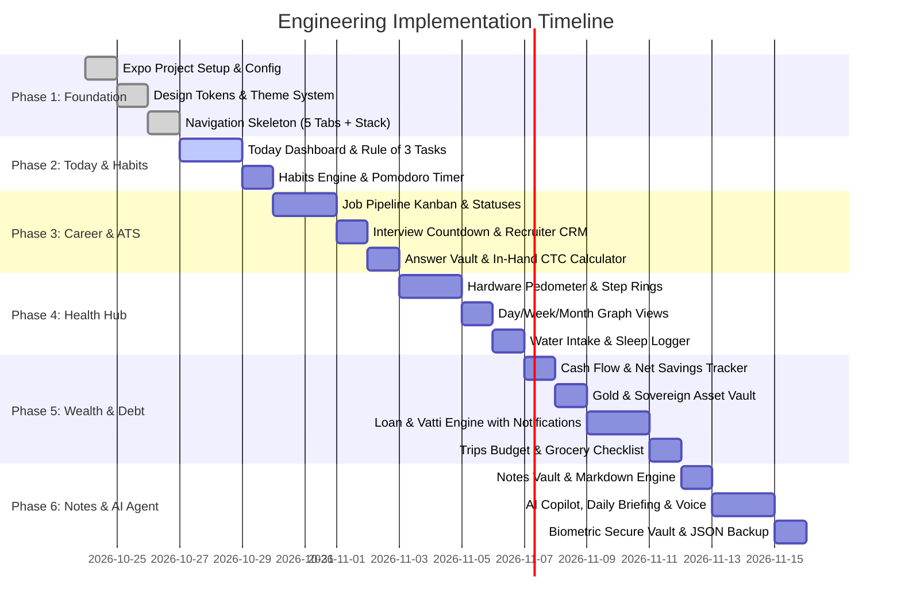

# 🗺️ Personal App: Implementation Roadmap & Milestones

**Project:** Personal Life OS & AI Executive Assistant  
**Target:** Production-Grade Expo (React Native) + TypeScript Application  

---

## 📅 Phased Execution Plan

---

## 🎯 Milestone Deliverables & Verification Checklist

### Milestone 1: Core Foundation & Design System
- [ ] Initialize clean Expo project with TypeScript template.
- [ ] Configure `app.config.js` with bundle ID, permissions, and app identity.
- [ ] Build Dark Glassmorphism design system (`colors.ts`, `spacing.ts`, `typography.ts`).
- [ ] Implement `BottomTabNavigator` with custom icons (Today, Career, Health, Vault, Agent).
- **Verification:** App boots up cleanly, tabs switch with zero stutter, dark mode theme renders smoothly.

### Milestone 2: Today Command Center & Habits Engine
- [ ] `useTaskStore`: Add, toggle, delete daily tasks with Rule-of-3 priority highlighting.
- [ ] Daily habit streak tracker with calendar history and fire streak counters.
- [ ] Built-in Pomodoro focus timer with interval bells and haptic feedback.
- **Verification:** Checking off a task persists across app reloads via AsyncStorage.

### Milestone 3: Career & Job Search (Personal ATS)
- [ ] `useJobStore`: Kanban stages (`Wishlist`, `Applied`, `Assessment`, `Interview`, `Offer`, `Rejected`).
- [ ] Interview countdown card with direct Google Meet/Zoom link launch.
- [ ] Recruiter CRM with 1-tap WhatsApp and LinkedIn outreach.
- [ ] In-Hand CTC Salary Calculator (Gross to Monthly take-home after tax deductions).
- [ ] Recruiter 1-Tap Copy "Answer Vault".
- **Verification:** New job addition moves seamlessly across stages; CTC calculation verifies accurately against Indian tax formulas.

### Milestone 4: Health & Vitality Hub (Google Fit Inspired)
- [ ] `useHealthStore`: Real-time hardware step tracking via `expo-sensors` Pedometer.
- [ ] Circular Goal Ring (Steps, Kcal, Distance).
- [ ] 3-View Switcher: Day (hourly bars), Week (7-day bar chart), Month (30-day heatmap).
- [ ] Interactive Water Bottle Tracker (+250ml, +500ml quick logs).
- [ ] Sleep logger with automatic sleep debt calculation.
- **Verification:** Walking with device increments step count; Week and Month charts reflect logged data accurately.

### Milestone 5: Smart Wealth, Gold & Loan (Vatti) Engine
- [ ] `useMoneyStore`: Monthly Income, Total Expenses, and Net Savings rate %.
- [ ] Gold Asset Vault: Grams and Sovereign (Savaran) calculator with live estimated value.
- [ ] **Kadan & Vatti Engine:**
  - Automated monthly interest: `(Principal × Rate) / 100`.
  - Next month due date alerts scheduled via `expo-notifications`.
  - Principal part-repayment auto recalculation.
  - 1-tap receipt/statement dispatch via email or WhatsApp.
- [ ] Trip & Vacation Budget Manager (Category expenses & group split).
- [ ] Family Grocery Interactive Checklist with instant checkout total calculation.
- **Verification:** ₹2,00,000 at 2% computes to ₹4,000/month; paying ₹50,000 immediately recalculates next month to ₹3,000.

### Milestone 6: Notes & AI Executive Copilot
- [ ] `useNoteStore`: Markdown formatting, tag filtering, code block syntax highlighting.
- [ ] `useAgentStore`: Conversational AI interface with natural language command parser:
  - Text & voice morning executive briefing.
  - Direct tool execution (e.g., *"Add application: Swiggy..."*).
  - 10-minute Pre-Interview Flashcard simulator.
- [ ] Biometric Fingerprint / Face ID unlock for confidential documents.
- [ ] 1-Tap JSON data export & restore.
- **Verification:** Voice commands speak back via `expo-speech`; biometric prompt successfully protects vault.

---

## 🧪 Testing & Quality Assurance
1. **Unit Testing:** Math formulas for Vatti interest, CTC net salary, and step calories.
2. **Persistence Stress Testing:** App kill and restart while maintaining 100% data integrity in AsyncStorage.
3. **Sensor Fault Tolerance:** Graceful fallback when pedometer permissions are pending or device lacks hardware pedometer.
