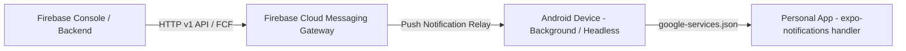

# 🚀 Google Play Store Production & Compliance Blueprint

**App Name:** Personal App (Life OS & AI Copilot)  
**Target Platform:** Android (Google Play Store Release) & iOS (TestFlight / App Store)  
**Build Tooling:** Expo Application Services (EAS Build) / Android App Bundle (`.aab`)  
**Target SDK:** Android 14+ (API Level 34 / 35 - Google Play Mandatory Requirement)  

---

## 1. Google Play Console Core Identity & Configuration

### 1.1 Package Name / Application ID
- **Production Package Name:** `com.bharathi.personalapp` (or custom reverse-domain).
- Must be unique, registered once on Google Play Console, and permanent across all updates.

### 1.2 Versioning Strategy
- **`versionName` (Semantic Versioning):** `1.0.0` (visible to users on the Play Store).
- **`versionCode` (Integer for Play Console):** `1`, `2`, `3`... (must increment strictly by +1 for every release upload; Play Console rejects identical or lower version codes).
- Configured in `app.config.js`:
  ```javascript
  android: {
    package: "com.bharathi.personalapp",
    versionCode: 1,
    adaptiveIcon: {
      foregroundImage: "./assets/brand/adaptive-icon.png",
      backgroundColor: "#09090B",
      monochromeImage: "./assets/brand/monochrome-icon.png" // Android 13+ Themed Icons
    },
    permissions: [
      "android.permission.ACTIVITY_RECOGNITION",
      "android.permission.POST_NOTIFICATIONS",
      "android.permission.USE_BIOMETRIC"
    ],
    allowBackup: false // Prevents sensitive loan & financial data from leaking to cloud backup
  }
  ```

---

## 2. Google Play Policy Compliance & Permissions Defense

Google Play conducts strict automated and manual reviews. Every permission must have an explicit in-app rationale modal before requesting system permission.

### 2.1 Permission Audit & Declarations:

| Permission | Purpose in App | Play Store Policy Justification |
|---|---|---|
| `ACTIVITY_RECOGNITION` | Live step tracking & active minutes | Mandatory for fitness/health step counter; requested with friendly in-app explanation. |
| `POST_NOTIFICATIONS` | Vatti due dates & water reminders | Required for Android 13+ (API 33+) local notifications; only scheduled by user consent. |
| `USE_BIOMETRIC` | Unlock secure confidential documents & loans | Device-level fingerprint/face security; no biometric data leaves the device hardware secure enclave. |

> [!IMPORTANT]
> **No Invasive Permissions:** We deliberately do **NOT** request `READ_SMS`, `READ_CONTACTS`, or `ACCESS_FINE_LOCATION`. This guarantees fastest 24-hour Google Play automated review approval with zero policy strikes!

---

## 3. Google Play Data Safety Form Declarations

When publishing to Google Play, the Data Safety Form must be answered accurately:
1. **Data Collection:**
   - **Does this app collect or share user data?** ➔ **NO**.
   - All career notes, job applications, financial numbers (salary, loans, gold), and health metrics are stored **100% locally on the user's device** in sandboxed `AsyncStorage`.
2. **Security Practices:**
   - Data stored locally on device storage.
   - User has complete right and ability to delete or export all data at any time (via single-tap in Settings).

---

## 4. Google Play Asset & Design Guidelines

### 4.1 Iconography & Graphics Requirements:
- **App Icon:** 512 x 512 px 32-bit PNG with alpha.
- **Adaptive Icon:** 432 x 432 px canvas with foreground elements in safe central 264 x 264 px circle.
- **Feature Graphic:** 1024 x 500 px PNG/JPEG (displayed in Play Store header).
- **Screenshots:** Minimum 4 high-resolution screenshots (1080 x 2400 px) showcasing:
  1. *Today Command Center & Daily Briefing*
  2. *Career & Job Search ATS Pipeline*
  3. *Google Fit Style Health & Steps Ring*
  4. *Smart Wealth, Gold & Vatti (Loan Interest) Engine*

---

## 5. Build Automation & Release Pipeline (`eas.json`)

To build production-ready Android App Bundles (`.aab`) signed with Google Play App Signing:

```json
{
  "cli": {
    "version": ">= 12.0.0"
  },
  "build": {
    "development": {
      "developmentClient": true,
      "distribution": "internal"
    },
    "preview": {
      "distribution": "internal",
      "android": {
        "buildType": "apk"
      }
    },
    "production": {
      "android": {
        "buildType": "app-bundle"
      }
    }
  },
  "submit": {
    "production": {
      "android": {
        "serviceAccountKeyPath": "./google-services-key.json",
        "track": "internal"
      }
    }
  }
}
```

### Build Commands:
- **Local Testing APK (Direct install on Android phone):**
  ```bash
  npx eas build --profile preview --platform android --local
  ```
- **Production Google Play Store App Bundle (`.aab`):**
  ```bash
  npx eas build --profile production --platform android
  ```

---

## 7. Environment Variables & API Key Security (`.env`)

To prevent API keys (Gemini API, weather API, etc.) from leaking to GitHub or reverse-engineered APKs:

### 7.1 `.env` Architecture
- **`.gitignore` Protection:**
  ```gitignore
  # Secrets & Local Configurations
  .env
  .env.local
  .env.production
  *.keystore
  *.jks
  google-services-key.json
  ```
- **`.env.example` Template:**
  Provides placeholder keys for clean repository cloning:
  ```bash
  EXPO_PUBLIC_APP_ENV=development
  EXPO_PUBLIC_GEMINI_API_KEY=your_gemini_api_key_here
  EXPO_PUBLIC_WEATHER_API_KEY=your_weather_api_key_here
  ```
- **Type-Safe Access (`src/config/env.ts`):**
  Environment variables are accessed with fallback safety and strict TypeScript validation:
  ```typescript
  export const ENV = {
    GEMINI_API_KEY: process.env.EXPO_PUBLIC_GEMINI_API_KEY || '',
    WEATHER_API_KEY: process.env.EXPO_PUBLIC_WEATHER_API_KEY || '',
    IS_DEV: __DEV__,
  };
  ```
- **In-App Dynamic Override:**
  Users can also paste or change their own API key directly from `Settings > AI Copilot Key`, stored securely on device hardware via `expo-secure-store`.

---

## 8. Google Firebase Console & Push Notification Relay (FCM)

For production-grade push notifications that can be triggered from the **Google Firebase Console** (Notification Composer), automated cron jobs, or server relays:



### 8.1 Firebase Integration Configuration
- **`google-services.json` Setup:**
  Downloaded from Firebase Console (`Project Settings > General > Your Apps > Android App`) and placed in project root (ignored in `.gitignore`, with template `google-services.json.example`).
- **`app.config.js` Linkage:**
  ```javascript
  android: {
    package: "com.bharathi.personalapp",
    googleServicesFile: process.env.GOOGLE_SERVICES_JSON || "./google-services.json",
    permissions: [
      "android.permission.ACTIVITY_RECOGNITION",
      "android.permission.POST_NOTIFICATIONS",
      "android.permission.USE_BIOMETRIC"
    ]
  },
  plugins: [
    [
      "expo-notifications",
      {
        icon: "./assets/brand/notification-icon.png",
        color: "#10B981",
        sounds: ["./assets/sounds/bell.wav"]
      }
    ]
  ]
  ```

### 8.2 Device Push Token Lifecycle (`core/native-bridges/notification-engine.ts`)
- On app launch, requests `POST_NOTIFICATIONS` permission (Android 13+).
- Retrieves the hardware **FCM Device Registration Token**:
  ```typescript
  import * as Notifications from 'expo-notifications';

  export async function registerForPushNotificationsAsync(): Promise<string | null> {
    const { status: existingStatus } = await Notifications.getPermissionsAsync();
    let finalStatus = existingStatus;
    if (existingStatus !== 'granted') {
      const { status } = await Notifications.requestPermissionsAsync();
      finalStatus = status;
    }
    if (finalStatus !== 'granted') return null;

    // Direct FCM Registration Token for Firebase Console testing
    const deviceToken = (await Notifications.getDevicePushTokenAsync()).data;
    console.log('[FCM Push Token]:', deviceToken);
    return deviceToken;
  }
  ```

### 8.3 Firebase Console Notification Scenarios
- **Direct Testing from Console:** Paste device token into Firebase Console `Campaigns > Notifications > Send Test Message`.
- **Scheduled Background Alerts:**
  - *"Reminder: Monthly vatti for Kumar Anna is due tomorrow!"*
  - *"Interview in 1 hour with Swiggy!"*
  - *"Don't break your 12-day coding habit streak!"*
- **Foreground & Background Handler:** Uses `Notifications.setNotificationHandler` to show heads-up banner even when app is open or closed in background.

---

## 9. Pre-Launch Quality Checklist

- [ ] **Target SDK:** API 34+ configured.
- [ ] **Android 64-bit Compliance:** React Native New Architecture (Hermes engine) enabled by default.
- [ ] **Crash-Free Guarantee:** Error boundaries wrapping every navigation tab.
- [ ] **Edge-to-Edge Navigation:** Android gesture bar & status bar transparently integrated.
- [ ] **Offline Resilience:** App never crashes when flight mode / zero network is active.
- [ ] **Privacy Policy URL:** Hosted markdown page ready for the Play Console listing.
- [ ] **API Keys Safeguarded:** Zero secrets hardcoded in source code; `.env` verified in `.gitignore`.
- [ ] **Firebase FCM Integrated:** `google-services.json` linked & push token handler verified.


